## Contents

* [About](ABOUT.md)
* [Main Font Gallery](#the-gallery)
* [Free, Non-Distrib EULA Font Gallery](NONDISTRIB.md)
* [Contribute to the Project](CONTRIBUTING.md)
* [Contributor List](CONTRIBUTORS.md)
* [License](LICENSE.md)

## Fun Little Rant About Font Customization

<blockquote>"Stop wasting your braintime on meaningless stuff like this and get back to coding. If you replace 'font' with some cosmetic product y'all sound like a bunch of valley girls."

-- Some Guy on Reddit</a>
</blockquote>

[Link](https://www.reddit.com/r/programming/comments/39wz4l/hey_reddit_developers_what_is_your_favorite_text/cs86fnu)

## The Gallery

### [Anonymous Pro](fonts/anonymous-pro)

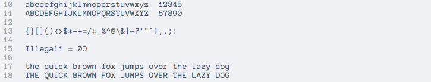
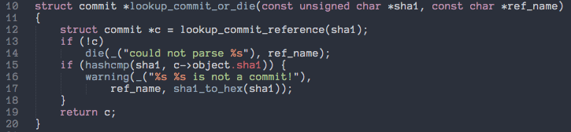
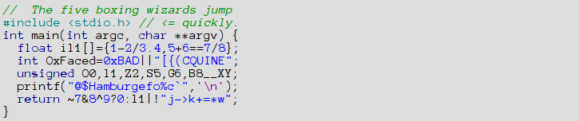

### [Aurulent Sans Mono](fonts/aurulent-sans-mono)

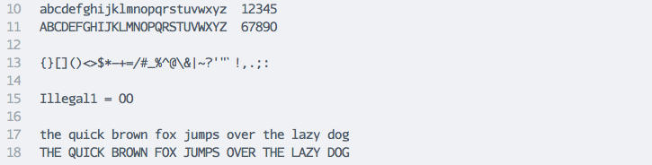

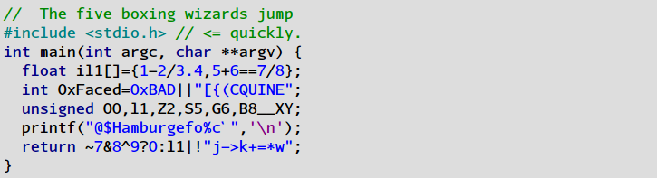

### [Bitstream Vera Sans Mono](fonts/bitstream-vera-sans-mono)

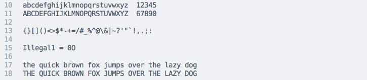

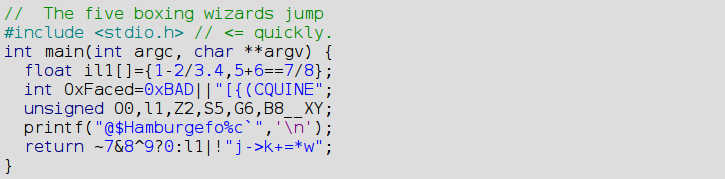

### [BP Mono](fonts/bp-mono)

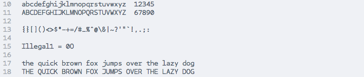

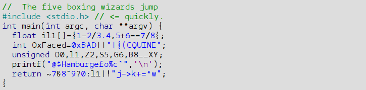

### [Code New Roman](fonts/code-new-roman)

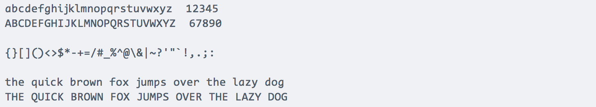

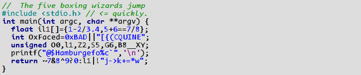

### [Coding Font Tobi](fonts/coding-font-tobi)

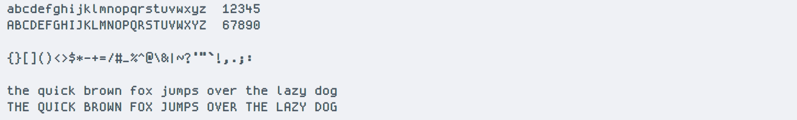
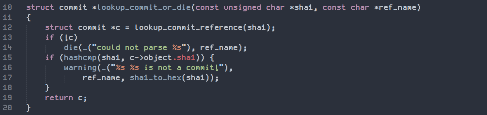
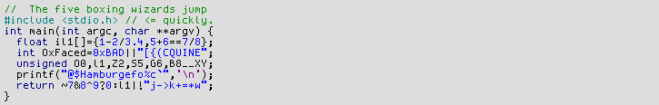

### [Consola Mono](fonts/consola-mono)

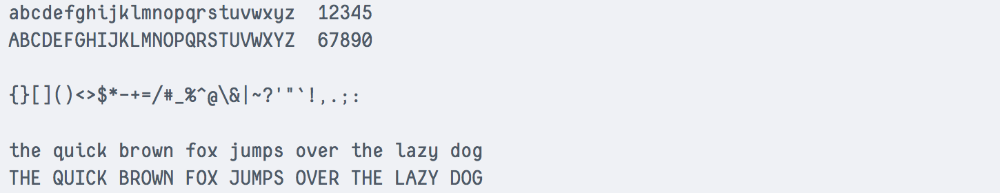

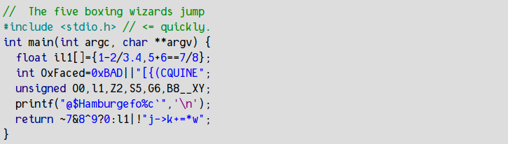

### [Cousine](fonts/cousine)

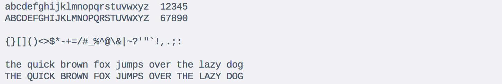

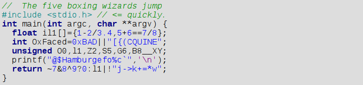

### [Crisp](fonts/crisp)

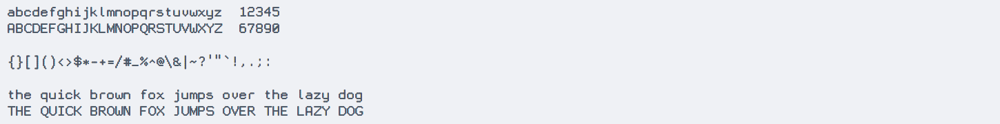
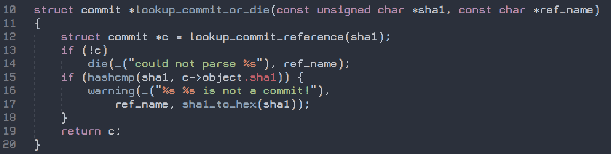
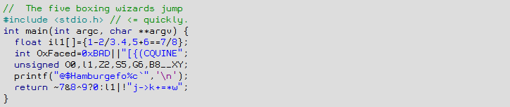

### [Cutive Mono](fonts/cutive-mono)

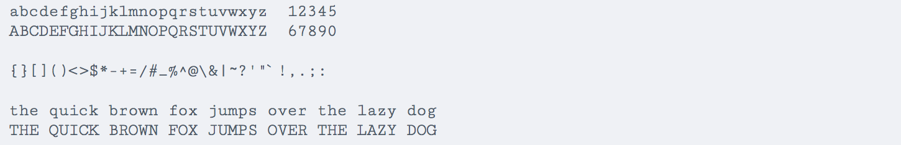

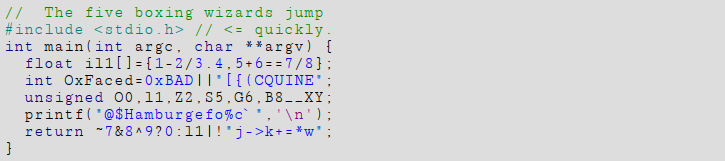

### [Dejavu Sans Mono](fonts/dejavu-sans-mono)

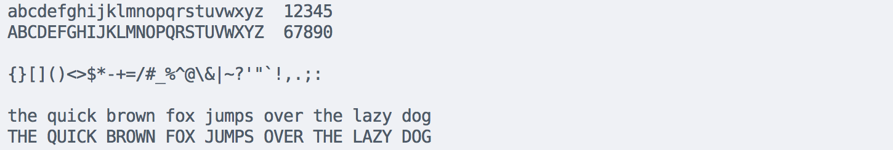
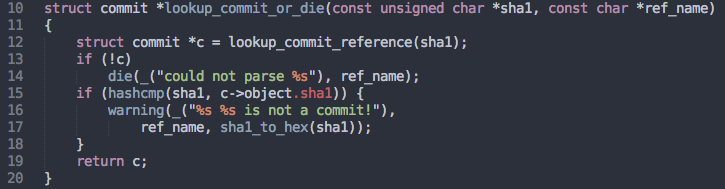
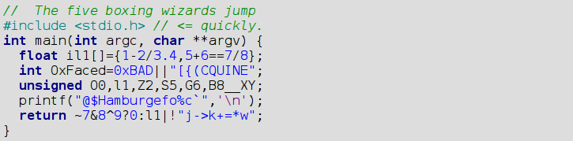

### [Dina](fonts/dina)

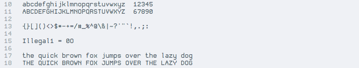
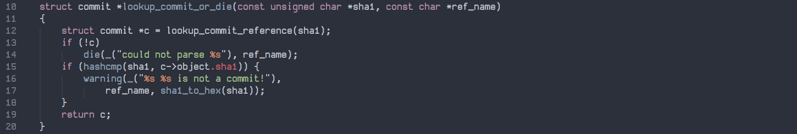
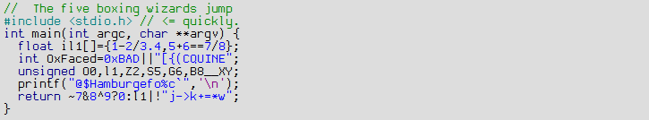

### [Droid Sans Mono](fonts/droid-sans-mono)

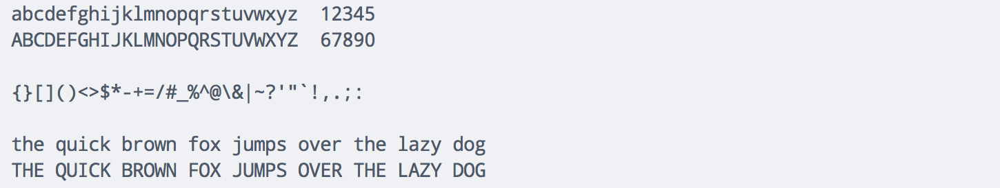
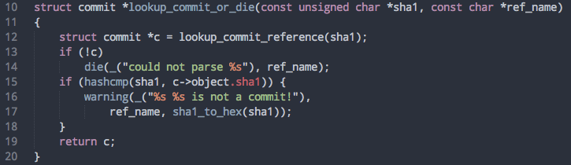
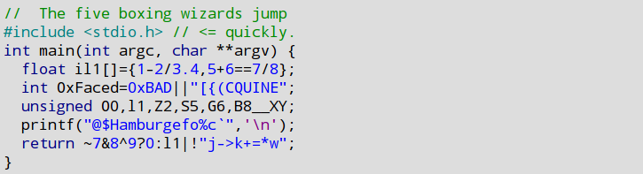

### [Edlo](fonts/edlo)

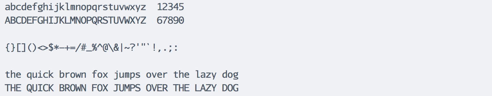

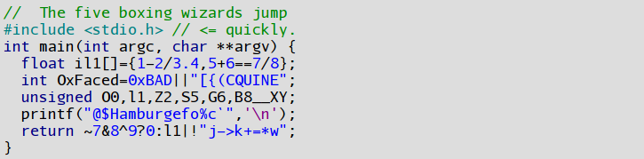

### [Elronet Monospace](fonts/elronet-monospace)

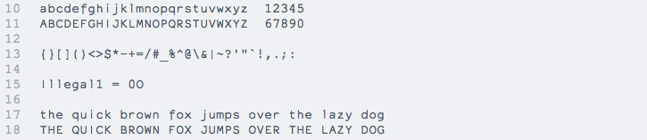
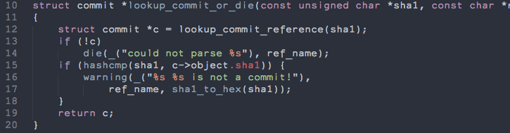
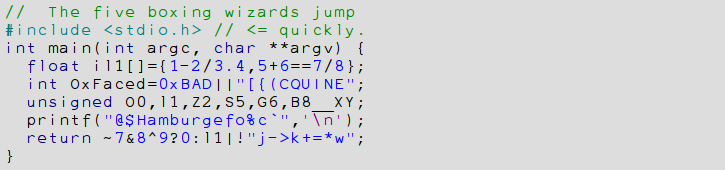

### [Fantasque Sans Mono](fonts/fantasque-sans-mono)

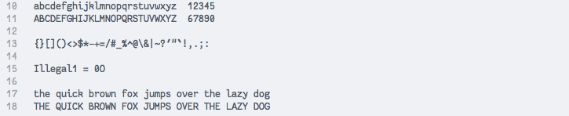
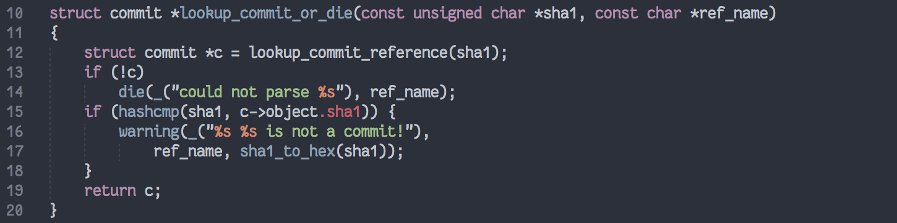
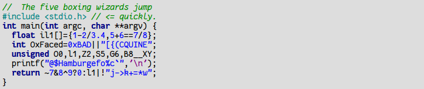

### [Fixedsys Excelsior](fonts/fixed-sys-excelsior)

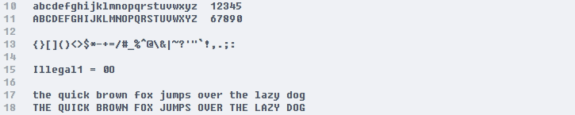
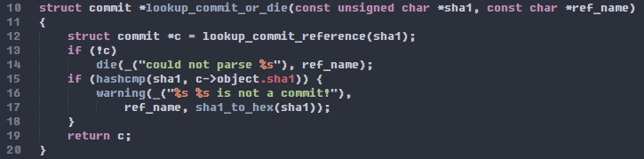
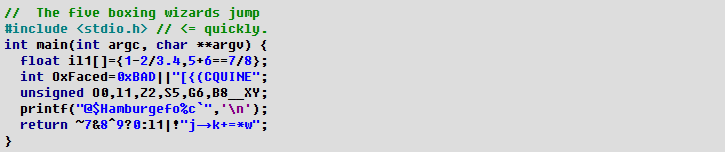

### [Fira Mono](fonts/fira-mono)

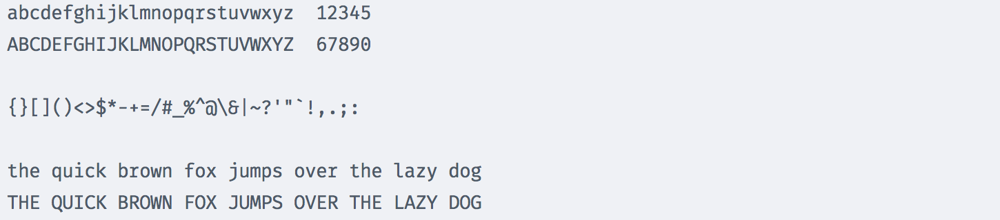
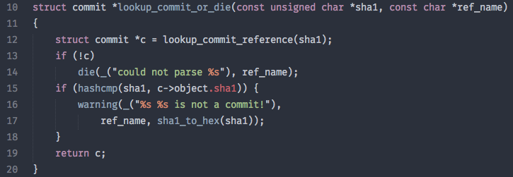
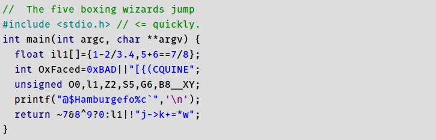

### [Free Mono](fonts/free-mono)

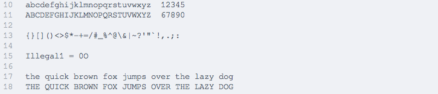
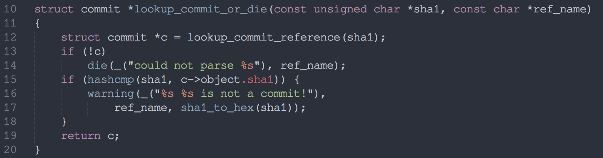
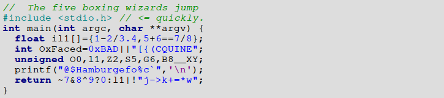

### [Inconsolata](fonts/inconsolata)

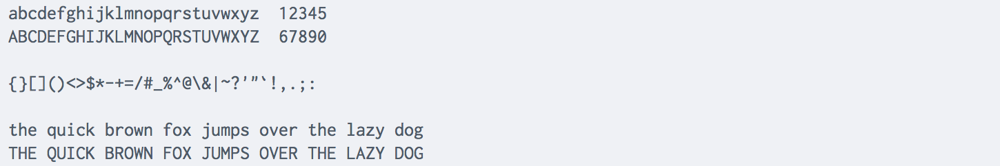

### [Inconsolata-dz](fonts/inconsolata-dz)

### [Inconsolata-g](fonts/inconsolata-g)

### [Inconsolata LGC](fonts/inconsolata-lgc)

### [Liberation Mono](fonts/liberation-mono)

### [Lekton](fonts/lekton)

### [Luculent](fonts/luculent)

### [Luxi Mono](fonts/luxi-mono)

### [M+ 1m](fonts/mplus1m)

### [M+ 2m](fonts/mplus2m)

### [Meslo](fonts/meslo)

### [Metrickal](fonts/metrickal)

### [Monofur](fonts/monofur)

### [Monoid](fonts/monoid)

### [monoOne](fonts/mono-one)

### [Mono MMM 5](fonts/mono-mmm-5)

### [Monospace](fonts/monospace)

### [Monospace Typewriter](fonts/monospace-typewriter)

### [Mono Spatial](fonts/mono-spatial)

### [Not Courier Sans](fonts/not-courier-sans)

### [Office Code Pro](fonts/office-code-pro)

### [Oxygen Mono](fonts/oxygen-mono)

### [Panic Sans Mono](fonts/panic-sans-mono)

### [PixelCarnage Mono](fonts/pixel-carnage)

### [ProFontWindows](fonts/pro-font-windows)

### [Proggy Clean](fonts/proggy-clean)

### [Proggy Small](fonts/proggy-small)

### [Proggy Square](fonts/proggy-square)

### [Proggy Tiny](fonts/proggy-tiny)

### [PT Mono](fonts/pt-mono)

### [Roboto Mono](fonts/roboto-mono)

### [sax Mono](fonts/sax-mono)

### [Share-TechMonoTrue](fonts/share-tech-mono)

### [Small Type Writing](fonts/small-type-writing)

### [Source Code Pro](fonts/source-code-pro)

### [SV Basic Manual](fonts/sv-basic-manual)

### [Terminus](fonts/terminus)

### [TeX Gyre Cursor](fonts/tex-gyre-cursor)

### [Ubuntu Mono](fonts/ubuntu-mono)

### [Verily Serif Mono](fonts/verily-serif-mono)

---

§ A proud member of the [Awesome Syndicate](https://github.com/sindresorhus/awesome)
